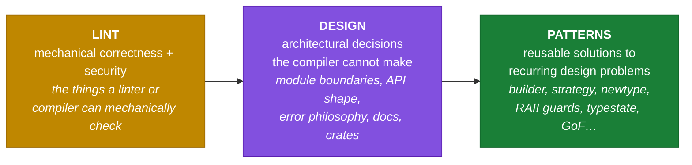
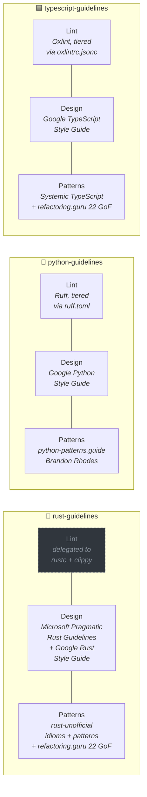

# lang-guidelines

Three language-specific Agent Skills that put design guidelines, idiomatic
patterns and lint rules in front of an AI agent while it writes or edits code —
not only during review.

- **`rust-guidelines/`** — Microsoft's Pragmatic Rust Guidelines + Google Rust
  Style Guide (design) + rust-unofficial patterns + 22 Gang-of-Four patterns
  adapted to Rust (refactoring.guru). Mechanical checks are left to `rustc` +
  `clippy`.
- **`python-guidelines/`** — Google Python Style Guide (design) +
  python-patterns.guide by Brandon Rhodes (patterns), with Ruff enforcing the
  tiered lint rules through a bundled `ruff.toml`.
- **`typescript-guidelines/`** — Google TypeScript Style Guide (design) +
  Systemic TypeScript (Vincent Alandev) + 22 Gang-of-Four patterns adapted to
  TypeScript (refactoring.guru), with Oxlint enforcing the tiered lint rules
  through a bundled `oxlintrc.jsonc`.

Each skill is a self-contained folder following the open
[Agent Skills standard](https://agentskills.io). Works unchanged with
Claude Code, Codex, Gemini CLI, Cursor, VS Code, GitHub Copilot, OpenCode,
OpenHands, Goose, and [30+ other agents](https://agentskills.io/home).

## What a skill gives the agent

Each skill packages three conceptual layers of knowledge, from the most
mechanical to the most architectural. An agent that loads the skill writes
code informed by **all three layers at once**.



*The layers are cumulative: fixing every lint violation does not produce
good code — it produces mechanically-correct code. Good code requires the
layers above.*

## Install

### Recommended — `skills` CLI ([skills.sh](https://skills.sh/))

The open-ecosystem CLI from Vercel Labs supports 45+ agents (Claude Code,
Codex, Cursor, Gemini, OpenCode, Copilot, Goose, Windsurf, Amp, Kiro,
Factory Droid, Roo, Cline, …). One command per project or global:

```bash
# Install all three skills globally (symlinked, easy updates)
npx skills add youssef-tharwat/lang-guidelines --all -g

# Or install just one
npx skills add youssef-tharwat/lang-guidelines --skill python-guidelines -g

# Or scope to a single project
cd my-project
npx skills add youssef-tharwat/lang-guidelines --all

# Target specific agents
npx skills add youssef-tharwat/lang-guidelines --all -a claude-code -a cursor
```

Browse the live leaderboard at <https://skills.sh/> or search for the repo at
`skills.sh/youssef-tharwat/lang-guidelines` once install telemetry accumulates.

### Manual — `git clone` + symlinks

For agents not yet supported by the CLI, or for custom install locations:

```bash
git clone https://github.com/youssef-tharwat/lang-guidelines ~/src/lang-guidelines

# Claude Code
ln -s ~/src/lang-guidelines/rust-guidelines       ~/.claude/skills/rust-guidelines
ln -s ~/src/lang-guidelines/python-guidelines     ~/.claude/skills/python-guidelines
ln -s ~/src/lang-guidelines/typescript-guidelines ~/.claude/skills/typescript-guidelines

# Gemini CLI (~/.gemini/skills/), Codex, OpenCode, … — same pattern, different target dir.
# See per-agent docs at https://agentskills.io/home.
```

### Direct copy (any agent)

```bash
cp -R rust-guidelines       <agent-skills-dir>/
cp -R python-guidelines     <agent-skills-dir>/
cp -R typescript-guidelines <agent-skills-dir>/
```

## What's inside

Each `SKILL.md` body is a **rule card**: one line per design rule, grouped by
the decision being made, with conflicts between upstream sources already
resolved. That card is all an agent reads up front. The full upstream text,
examples and lint documentation stay on disk until a task needs them.

### What the agent sees at trigger time

| Skill | Always loaded | On demand | Framework-gated |
|---|---|---|---|
| `rust-guidelines` | `SKILL.md` (32 KB: 106-rule card + 28-pattern index) | `rules/<id>.md` · `patterns/<id>.md` · `lints.toml` | — |
| `python-guidelines` | `SKILL.md` (16 KB: 39-rule card + 15-pattern index) | `rules/<id>.md` · `patterns/<id>.md` · `ruff.toml` · `lint/<rule>/index.md` · `style.md` (275 Tier 3 rules) | `frameworks/{airflow,django,fastapi,numpy,pandas}.md` |
| `typescript-guidelines` | `SKILL.md` (20 KB: 45-rule card + 29-pattern index) | `rules/<id>.md` · `patterns/<id>.md` · `oxlintrc.jsonc` · `lint/<plugin>/<rule>/index.md` · `style.md` (280 Tier 3 rules) | `frameworks/{jest,jsdoc,nextjs,react,vitest,vue}.md` |

Python and TypeScript keep their Tier 1 (correctness, security) and Tier 2
(modernization, performance) lint rules out of the card: the bundled
`ruff.toml` and `oxlintrc.jsonc` select them, so the linter enforces them
mechanically, as `rustc` and `clippy` do for Rust.

### Measured

Each restructure was A/B-tested against the always-load layout it replaced,
on a fixed suite of coding tasks. The protocols and per-case results are in
`evals/<skill>/results/`.

### Folder layout

```
<language>-guidelines/   # the skill; generated by build/compile.py
├── SKILL.md             # the rule card + pattern index
├── rules/<id>.md        # one rule: card line + every upstream section it cites
├── patterns/<id>.md     # one pattern: its upstream page(s)
├── lints.toml | ruff.toml | oxlintrc.jsonc   # generated lint configuration
└── lint/ style.md frameworks/                # Python/TS only: vendored lint docs

sources/<language>/      # upstream text + PROVENANCE.md (origin, date, sha256)
build/
├── compile.py           # python3 build/compile.py <rust|python|typescript> [--check]
├── fetch/               # converters that produce sources/ from upstream pages
├── skillc/              # parsers, manifest validation, rendering
└── <language>/
    ├── manifest.toml    # every upstream unit → rule, pattern, lint or exclusion
    └── SKILL.template.md
evals/
├── run-ab.sh            # A/B one skill version against another on its cases
├── compare.py           # score, tokens, turns and cost per arm
└── <skill>/cases/ results/
```

The compiler owns every file in a skill folder except the vendored lint
documentation (`lint/`, `style.md`, `frameworks/`), which it only checks.

## How the agent uses a skill

1. At startup the agent reads every skill's `name` and `description` from
   `SKILL.md` frontmatter (always in context).
2. When a task matches a skill's description, the agent loads the `SKILL.md`
   body: the rule card and the pattern index.
3. It writes code against the card. It opens `rules/<id>.md` only when it
   needs a rule's full text, examples or exceptions, and `patterns/<id>.md`
   before choosing between the designs a pattern covers.
4. For Python and TypeScript, it lints what it changes with the project's
   linter configuration, or the bundled one, and looks rules up in `lint/`.
5. For style reviews or framework-specific work, it loads `style.md` or
   `frameworks/<name>.md`.

## Source attribution

Different languages have different canonical sources for each layer. Every
cell below is sourced from a named upstream.



### Full source list

**Rust**
- Design guidelines: [microsoft/rust-guidelines](https://github.com/microsoft/rust-guidelines) — Microsoft's Pragmatic Rust Guidelines
- Design guidelines: [google.github.io/styleguide/rustguide.html](https://google.github.io/styleguide/rustguide.html) — Google Rust Style Guide
- Community patterns: [rust-unofficial.github.io/patterns](https://rust-unofficial.github.io/patterns/) — Rust idioms, design patterns, anti-patterns, functional patterns
- Classical patterns: [refactoring.guru/design-patterns/rust](https://refactoring.guru/design-patterns/rust) — 22 Gang-of-Four patterns with Rust examples
- **Mechanical checks**: delegated to [`rustc`](https://doc.rust-lang.org/rustc/) + [`clippy`](https://doc.rust-lang.org/clippy/).

**Python**
- Lint rules: [docs.astral.sh/ruff/rules/](https://docs.astral.sh/ruff/rules/) — Ruff
- Design guidelines: [google.github.io/styleguide/pyguide.html](https://google.github.io/styleguide/pyguide.html) — Google Python Style Guide
- Design patterns: [python-patterns.guide](https://python-patterns.guide/) — Brandon Rhodes

**TypeScript / JavaScript**
- Lint rules: [oxc.rs/docs/guide/usage/linter/rules](https://oxc.rs/docs/guide/usage/linter/rules) — Oxlint
- Design guidelines: [google.github.io/styleguide/tsguide.html](https://google.github.io/styleguide/tsguide.html) — Google TypeScript Style Guide
- Systemic architecture: [valand.dev/systemic-ts](https://valand.dev/systemic-ts) — Systemic TypeScript by Vincent Alandev
- Design patterns: [refactoring.guru/design-patterns/typescript](https://refactoring.guru/design-patterns/typescript) — 22 GoF patterns with TS examples

Rule text, examples, and configuration are from the upstream documentation.
The card lines are one-line digests written in `build/<language>/manifest.toml`;
the upstream text they summarize is kept in `sources/<language>/` (see each
`PROVENANCE.md`) and reproduced in the `rules/` and `patterns/` files, under
each upstream's license (a mix of MIT, MPL-2.0, CC BY and CC BY-SA — see
License below).

## License

Project scaffolding, compiled digests, tiering, and imperative rewrites in
this repo are MIT. Per-source content retains its upstream license:

- **Microsoft Pragmatic Rust Guidelines** — MIT
- **rust-unofficial/patterns** — MPL-2.0
- **Ruff rules** — MIT (Astral)
- **Oxlint rules** — MIT (Oxc project)
- **Google Python, TypeScript and Rust style guides** — CC BY 3.0
- **python-patterns.guide** — content copyright Brandon Rhodes,
  redistributed with attribution for agent reference; canonical
  authoritative version lives at the source URL.
- **Systemic TypeScript** — content copyright Vincent Alandev,
  redistributed with attribution for agent reference.
- **refactoring.guru (TypeScript / Rust GoF examples)** —
  CC BY-SA 4.0; example code retains its source licensing. Per the
  ShareAlike clause, any derivative redistributed downstream must carry the
  same CC BY-SA 4.0 license on the refactoring.guru-sourced sections.

## Contributing

Issues and PRs welcome.

To change a skill, edit `build/<language>/manifest.toml` or its
`SKILL.template.md`, then run `python3 build/compile.py <language>`. To pick up
upstream changes, refresh `sources/<language>/` (record the new origin and
sha256 in its `PROVENANCE.md`) and map any new upstream sections in the
manifest: the compiler refuses to build while any upstream section is
unmapped, and `python3 build/compile.py <language> --check` fails when the
committed skill folder is stale.

To measure a change, run `evals/run-ab.sh <skill> <earlier-skill-copy>
<output-dir>` and record the result, with its protocol, under
`evals/<skill>/results/`.
